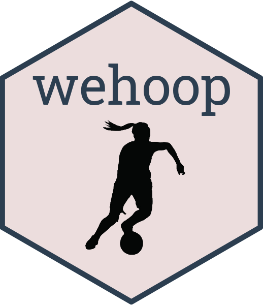
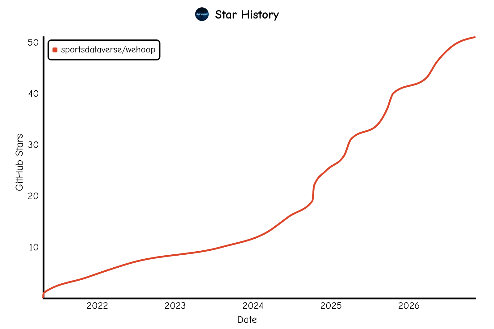

---
output:
  github_document:
    toc: true
    toc_depth: 2
---

# **wehoop** <a href='https://wehoop.sportsdataverse.org'></a>
```{r setup_readme, include = FALSE}
require(knitr)
# Counts below are computed from the installed namespace so they cannot drift.
wehoop_exports <- getNamespaceExports("wehoop")
n_exports <- function(prefix) sum(startsWith(wehoop_exports, prefix))
```

<!-- badges: start -->
[](https://CRAN.R-project.org/package=wehoop)
[](https://CRAN.R-project.org/package=wehoop)
[](https://sportsdataverse.r-universe.dev/wehoop)
[](https://github.com/sportsdataverse/wehoop/)
[](https://github.com/sportsdataverse/wehoop/actions/workflows/R-CMD-check.yaml)
[](https://app.codecov.io/gh/sportsdataverse/wehoop/tree/main)
[](https://github.com/sportsdataverse/wehoop/actions/workflows/pkgdown.yaml)
[](https://lifecycle.r-lib.org/articles/stages.html#stable)
[](https://github.com/sportsdataverse/wehoop/blob/main/LICENSE.md)
[](https://github.com/sportsdataverse/wehoop/graphs/contributors)
[](https://github.com/sportsdataverse/wehoop)
[](https://x.com/SportsDataverse)
[](https://x.com/SaiemGilani)
[](https://x.com/hutchngo)
<!-- badges: end -->

The goal of [**`wehoop`**](https://wehoop.sportsdataverse.org/) is to provide tools for working with women's college and professional basketball data. It exports `r length(wehoop_exports)` functions: live wrappers for ESPN, the WNBA Stats API, the NCAA, Fox Sports, Basketball-Reference, Her Hoop Stats, Bart Torvik, official.nba.com and eight international data providers, plus `r n_exports("load_")` `load_*()` functions that read pre-built season files (play-by-play, box scores, rosters, schedules, crosswalks and model outputs) instead of calling the sources.

## **Data status**

The `load_*()` functions read release assets on [sportsdataverse-data](https://github.com/sportsdataverse/sportsdataverse-data/releases). The badges below are rebuilt nightly from each producer's latest workflow run and newest release files; idle means the sport is out of season. Full detail: [sportsdataverse.org/status](https://sportsdataverse.org/status).

| Dataset | Data updated | Through | Pipeline | Update workflows |
|:--|:--|:--|:--|:--|
| [Women's college basketball (ESPN)](https://github.com/sportsdataverse/wehoop-wbb-data) | [](https://github.com/sportsdataverse/sportsdataverse-data/releases) | [](https://github.com/sportsdataverse/sportsdataverse-data/releases) | [](https://sportsdataverse.org/status#wehoop-wbb-data) | [](https://github.com/sportsdataverse/wehoop-wbb-data/actions/workflows/daily_wbb.yml) [](https://github.com/sportsdataverse/wehoop-wbb-data/actions/workflows/weekly_wbb.yml) [](https://github.com/sportsdataverse/wehoop-wbb-data/actions/workflows/wbb_models_cron.yml) |
| [Women's college basketball (stats.ncaa.org)](https://github.com/sportsdataverse/ncaa-wbb-hoops-data) | [](https://github.com/sportsdataverse/sportsdataverse-data/releases) | [](https://github.com/sportsdataverse/sportsdataverse-data/releases) | [](https://sportsdataverse.org/status#ncaa-wbb-hoops-data) | [](https://github.com/sportsdataverse/ncaa-wbb-hoops-data/actions/workflows/ncaa_wbb_models.yml) |
| [WNBA (ESPN)](https://github.com/sportsdataverse/wehoop-wnba-data) | [](https://github.com/sportsdataverse/sportsdataverse-data/releases) | [](https://github.com/sportsdataverse/sportsdataverse-data/releases) | [](https://sportsdataverse.org/status#wehoop-wnba-data) | [](https://github.com/sportsdataverse/wehoop-wnba-data/actions/workflows/daily_wnba.yml) [](https://github.com/sportsdataverse/wehoop-wnba-data/actions/workflows/weekly_wnba.yml) [](https://github.com/sportsdataverse/wehoop-wnba-data/actions/workflows/annual_wnba_draft.yml) |
| [WNBA Stats API](https://github.com/sportsdataverse/wehoop-wnba-stats-data) | [](https://github.com/sportsdataverse/sportsdataverse-data/releases) | [](https://github.com/sportsdataverse/sportsdataverse-data/releases) | [](https://sportsdataverse.org/status#wehoop-wnba-stats-data) | [](https://github.com/sportsdataverse/wehoop-wnba-stats-data/actions/workflows/daily_wnba_stats.yml) [](https://github.com/sportsdataverse/wehoop-wnba-stats-data/actions/workflows/wnba_models.yml) [](https://github.com/sportsdataverse/wehoop-wnba-stats-data/actions/workflows/annual_wnba_stats_draft.yml) |
| [Conference, division and ballpark reference](https://github.com/sportsdataverse/sdv-reference-data) | [](https://github.com/sportsdataverse/sportsdataverse-data/releases) | [](https://github.com/sportsdataverse/sportsdataverse-data/releases) | [](https://sportsdataverse.org/status#sdv-reference-data) | &mdash; |

## **Installation**

You can install the CRAN version of [**```wehoop```** ](https://CRAN.R-project.org/package=wehoop) with:
```{r readme_cran_install, eval=FALSE}
install.packages("wehoop")
```

You can install the latest build from [R-universe](https://sportsdataverse.r-universe.dev/wehoop) with:

```r
install.packages("wehoop", repos = c("https://sportsdataverse.r-universe.dev", getOption("repos")))
```

This documentation describes **wehoop `r packageVersion("wehoop")`**. If the CRAN release hasn't caught up yet, install the development version from [GitHub](https://github.com/sportsdataverse/wehoop) instead:

```r
if (!requireNamespace("pak", quietly = TRUE)) install.packages("pak")
pak::pak("sportsdataverse/wehoop")
# or, with remotes:
# if (!requireNamespace("remotes", quietly = TRUE)) install.packages("remotes")
# remotes::install_github("sportsdataverse/wehoop")
```


## **Quick start**

### **WNBA play-by-play for a season**

`load_wnba_pbp()` covers 2002-`r wehoop::most_recent_wnba_season()`; pass several seasons (or `seasons = TRUE` for all of them) to load more at once.
```{r wnba_load_pbp_readme}
wnba_pbp <- wehoop::load_wnba_pbp(seasons = 2026)
```

```{r wnba_pbp_message, echo = FALSE}
glue::glue("{nrow(wnba_pbp)} rows of WNBA play-by-play data from {length(unique(wnba_pbp$game_id))} games.")
```

### **Women's college basketball play-by-play for a season**

`load_wbb_pbp()` covers 2004 onward. A new season's file is published once its games begin.
```{r wbb_load_pbp_readme}
wbb_pbp <- wehoop::load_wbb_pbp(seasons = 2026)
```

```{r wbb_pbp_message, echo = FALSE}
glue::glue("{nrow(wbb_pbp)} rows of women's college basketball play-by-play data from {length(unique(wbb_pbp$game_id))} games.")
```

## **What's in wehoop**

Each family links to its section of the [function reference](https://wehoop.sportsdataverse.org/reference/index.html).

* **ESPN** ([`espn_wnba_*`, `espn_wbb_*`](https://wehoop.sportsdataverse.org/reference/index.html#espn-data)): `r n_exports("espn_wbb_") + n_exports("espn_wnba_")` wrappers (`r n_exports("espn_wbb_")` women's college + `r n_exports("espn_wnba_")` WNBA) for play-by-play, box scores, schedules, standings, teams, athletes, odds, win probability, the draft and transactions. The [ESPN endpoints article](https://wehoop.sportsdataverse.org/articles/espn-endpoints.html) walks through them.
* **WNBA Stats API** ([`wnba_*`](https://wehoop.sportsdataverse.org/reference/index.html#wnba-stats-data-functions)): stats.wnba.com box scores, play-by-play, league dashboards, player and team splits, shot charts and lineups.
* **WNBA officiating** ([`wnba_referee_assignments()`](https://wehoop.sportsdataverse.org/reference/index.html#wnba-officiating-functions)): official.nba.com's daily referee assignments.
* **NCAA** ([`ncaa_wbb_*`](https://wehoop.sportsdataverse.org/reference/index.html#ncaa-data)): NCAA team lists and NET rankings.
* **Fox Sports** ([`fox_wnba_*`, `fox_wbb_*`](https://wehoop.sportsdataverse.org/reference/index.html#fox-sports-data-functions)): play-by-play, box scores, odds, rosters, standings and leaders.
* **Basketball-Reference** ([`bref_wnba_*`](https://wehoop.sportsdataverse.org/reference/index.html#wnba-basketball-reference-functions)): WNBA player stats, team stats and standings.
* **Her Hoop Stats** ([`hhs_*`](https://wehoop.sportsdataverse.org/reference/index.html#her-hoop-stats-functions)): NCAA women's team indexes, team stats and rosters, for subscribers.
* **Bart Torvik** ([`bart_wbb_*`](https://wehoop.sportsdataverse.org/reference/index.html#wbb-crosswalk-functions)): women's college team ratings and game schedules.
* **Crosswalks** ([WNBA](https://wehoop.sportsdataverse.org/reference/index.html#wnba-crosswalk-functions), [WBB](https://wehoop.sportsdataverse.org/reference/index.html#wbb-crosswalk-functions)): team, player and game ids matched across ESPN, WNBA Stats, Fox and Torvik, built live (`wnba_*_crosswalk()`, `wbb_*_crosswalk()`) or loaded pre-built (`load_*_crosswalk()`).
* **International** ([reference](https://wehoop.sportsdataverse.org/reference/index.html#international-basketball)): FIBA (`fiba_*`), Genius Sports (`genius_*`), Sportradar Atrium (`atrium_*`), NBL / WNBL (`nbl_*`), SCB / DBBL (`scb_*`), FEB (`feb_*`), TBF (`tbf_*`) and the W League (`wjbl_*`), plus per-competition aliases such as `fiba_wwc_*`, `wbbl_*` and `lfb_*`. `r n_exports("fiba_") + n_exports("genius_") + n_exports("atrium_") + n_exports("nbl_") + n_exports("scb_") + n_exports("feb_") + n_exports("tbf_") + n_exports("wjbl_") + n_exports("nbl1_") + n_exports("lpb_") + n_exports("lnbp_") + n_exports("lmb_") + n_exports("wbbl_") + n_exports("lfb_")` functions in all.
* **Release loaders** ([WNBA](https://wehoop.sportsdataverse.org/reference/index.html#wnba-data-functions), [WBB](https://wehoop.sportsdataverse.org/reference/index.html#women-s-college-basketball-data-functions), [WNBA Stats](https://wehoop.sportsdataverse.org/reference/index.html#wnba-stats-api-data-loaders), [NCAA engine](https://wehoop.sportsdataverse.org/reference/index.html#ncaa-women-s-college-basketball-play-by-play-engine-data-loaders), [models](https://wehoop.sportsdataverse.org/reference/index.html#model-dataset-loaders), [conference groups](https://wehoop.sportsdataverse.org/reference/index.html#conference-and-division-group-loaders)): see below.

## **Bulk datasets**

The `r n_exports("load_")` `load_*()` functions read pre-built season files (rds or parquet) from the [sportsdataverse-data](https://github.com/sportsdataverse/sportsdataverse-data/releases) releases instead of calling the source APIs. Most take `seasons` and return a `wehoop_data` tibble (`load_wnba_draft_manifest()` takes no arguments and the `load_*_groups()` lineage tables are not split by season); most can also write to a database through `dbConnection` and `tablename`.

* **ESPN-backed** (`load_wnba_*`, `load_wbb_*`): play-by-play, player and team box scores, schedules, rosters, player and team season stats, standings, shots, game rosters, officials, player cores and the WNBA draft.
* **WNBA Stats API** (`load_wnba_stats_*`): play-by-play, schedules, rosters, coaches, player game logs, the league dashboard cube (`load_wnba_stats_leaguedash()`), draft, shots, game rosters, officials and possessions (`load_wnba_stats_possessions()`).
* **NCAA play-by-play engine** (`load_ncaa_wbb_*`, `r n_exports("load_ncaa_wbb_")` loaders): play-by-play, shots, lineups, matchup stints, possessions, RAPM (within-team and league-wide), box scores, rosters, schedules and team ids, built by [sportsdataverse-py](https://py.sportsdataverse.org/) from stats.ncaa.org.
* **Crosswalks** (`load_wnba_*_crosswalk()`, `load_wbb_*_crosswalk()`): the pre-built team, player and schedule crosswalks.
* **Models**: `load_wnba_player_impact()`, `load_wbb_player_value()` and `load_wbb_ratings()`.
* **Conference and division groups**: `load_wnba_groups()`, `load_wbb_groups()` and their `_group_seasons()`, `_group_aliases()` and `_team_group_seasons()` companions record membership as it was each season.

## **Documentation**

For more information on the package and function reference, please see the  [**`wehoop`** documentation website](https://wehoop.sportsdataverse.org).

- [Function reference](https://wehoop.sportsdataverse.org/reference/index.html)
- Vignettes:
  - [Getting Started with wehoop: WNBA and Women's College Basketball Data in R](https://wehoop.sportsdataverse.org/articles/getting-started-wehoop.html)
  - [ESPN basketball endpoints – WBB & WNBA](https://wehoop.sportsdataverse.org/articles/espn-endpoints.html)
  - [WNBA Stats API Parameter Descriptions](https://wehoop.sportsdataverse.org/articles/parameter-descriptions.html)
  - [Women's College Basketball Cookbook](https://wehoop.sportsdataverse.org/articles/wbb-cookbook.html)
  - [WNBA Cookbook](https://wehoop.sportsdataverse.org/articles/wnba-cookbook.html)
- Articles:
  - [WNBA Player Impact Model: RAPM, SPM, BPM, WAR and DARKO-Style Projections](https://wehoop.sportsdataverse.org/articles/wnba-player-impact-model.html)
  - [WNBA and Women's College Basketball Shot Charts in R](https://wehoop.sportsdataverse.org/articles/wnba-womens-college-basketball-shot-charts.html)
  - [Women's Basketball Advanced Metrics in R: Possessions, Pace, Ratings and the Four Factors](https://wehoop.sportsdataverse.org/articles/womens-basketball-advanced-metrics.html)
  - [Women's College Basketball Player Value: Box Plus-Minus Model](https://wehoop.sportsdataverse.org/articles/womens-college-basketball-player-value-model.html)
  - [Women's College Basketball RAPM: League-Wide and Within-Team Player Impact](https://wehoop.sportsdataverse.org/articles/womens-college-basketball-rapm-model.html)
  - [Women's College Basketball Team Ratings: Opponent-Adjusted Efficiency](https://wehoop.sportsdataverse.org/articles/womens-college-basketball-team-ratings-model.html)
  - [Women's College Basketball Win Probability Model](https://wehoop.sportsdataverse.org/articles/womens-college-basketball-win-probability-model.html)
  - [Women's International Basketball Data in R: FIBA, EuroLeague Women, WNBL, W League and More](https://wehoop.sportsdataverse.org/articles/womens-international-basketball-leagues.html)
- [News and release notes](https://wehoop.sportsdataverse.org/news/index.html)

There is also a printable [**`wehoop` cheat sheet (PDF)**](https://sportsdataverse.org/cheatsheets/wehoop.pdf), one of [a set covering every SportsDataverse package](https://sportsdataverse.org/cheatsheets).

The [Getting started](https://wehoop.sportsdataverse.org/articles/getting-started-wehoop.html) article is the place to begin; the [WNBA](https://wehoop.sportsdataverse.org/articles/wnba-cookbook.html) and [women's college](https://wehoop.sportsdataverse.org/articles/wbb-cookbook.html) cookbooks have worked recipes.

## **Breaking Changes**

[**Full News on Releases**](https://wehoop.sportsdataverse.org/news/index.html)

## **Companion packages**

- [**`sdvplotR`**](https://sdvplotR.sportsdataverse.org/) (0.3.0, `pak::pak("sportsdataverse/sdvplotR")`) adds team logos and colours to `ggplot2` charts and draws shot charts from the `wehoop` shot loaders; see its [WNBA](https://sdvplotR.sportsdataverse.org/articles/wnba-viz.html), [women's college](https://sdvplotR.sportsdataverse.org/articles/wbb-viz.html) and [shot chart](https://sdvplotR.sportsdataverse.org/articles/cookbook-surfaces-shot-charts.html) articles.
- [**`sportyR`**](https://sportyR.sportsdataverse.org/) (2.4.5, `install.packages("sportyR")`) draws WNBA, NCAA and FIBA courts to plot shot locations on.
- [**`hoopR`**](https://hoopR.sportsdataverse.org/) is the men's basketball companion (NBA and men's college basketball).
- [**`sportsdataverse-py`**](https://py.sportsdataverse.org/) is the Python package; most `wehoop` functions have a Python twin of the same name.

## **The SportsDataverse**

[**`wehoop`**](https://wehoop.sportsdataverse.org/) is part of the [SportsDataverse](https://sportsdataverse.org/), a set of
open-source packages for sports data.

| Package | Sport / Scope |
|---|---|
| [**cfbfastR**](https://cfbfastR.sportsdataverse.org/) | College football |
| [**hoopR**](https://hoopR.sportsdataverse.org/) | Men's basketball (NBA and NCAA) |
| [**wehoop**](https://wehoop.sportsdataverse.org/) | Women's basketball (WNBA and NCAA) |
| [**fastRhockey**](https://fastRhockey.sportsdataverse.org/) | Hockey (NHL and PWHL) |
| [**baseballr**](https://billpetti.github.io/baseballr/) | Baseball (MLB, MiLB, NCAA) |
| [**softballR**](https://github.com/sportsdataverse/softballR) | College softball |
| [**oddsapiR**](https://oddsapiR.sportsdataverse.org/) | Sports betting odds |
| [**recruitR**](https://recruitR.sportsdataverse.org/) | College football recruiting |
| [**usfootballR**](https://usfootballR.sportsdataverse.org/) | US soccer |
| [**cfbseedR**](https://cfbseedR.sportsdataverse.org/) · [**cfb4th**](https://cfb4th.sportsdataverse.org/) | CFB playoff simulation · fourth-down decisions |
| [**cfbplotR**](https://cfbplotR.sportsdataverse.org/) · [**sdvplotR**](https://sdvplotR.sportsdataverse.org/) · [**sportyR**](https://sportyR.sportsdataverse.org/) | Logos, colors, tables · playing surfaces |
| [**sportsdataverse-R**](https://r.sportsdataverse.org/) | Umbrella R metapackage |
| [**sportsdataverse-py**](https://py.sportsdataverse.org/) · [**sportsdataverse.js**](https://js.sportsdataverse.org/) | Python and Node.js |

See the full ecosystem at [sportsdataverse.org](https://sportsdataverse.org/).

## **Follow the [SportsDataverse](https://x.com/SportsDataverse) on X and star this repo**

[](https://x.com/SportsDataverse)

[](https://github.com/sportsdataverse/wehoop)

<a href="https://github.com/sportsdataverse/wehoop">
  <picture>
    <source media="(prefers-color-scheme: dark)" srcset="https://raw.githubusercontent.com/sportsdataverse/wehoop/star-history/star-history-dark.svg">
    
  </picture>
</a>


## **Our Authors**

-   [Saiem Gilani](https://x.com/saiemgilani)

<a href="https://x.com/saiemgilani" target="blank"></a> <a href="https://github.com/saiemgilani" target="blank"></a>

-   [Geoff Hutchinson - RIP](https://x.com/hutchngo)

<a href="https://x.com/HutchNGo" target="blank"></a> <a href="https://github.com/hutchngo" target="blank"></a>


<!-- cheatsheet-section -->
## **Cheat sheet**

A printable one-page reference for **`wehoop`** — the function families, the loaders, and what each one returns.

📄 **[Download the wehoop cheat sheet (PDF)](https://sportsdataverse.org/cheatsheets/wehoop.pdf)**

Free to download, print and hand out; light and dark, US Letter landscape.
Every SportsDataverse package has one — browse them all at
**[sportsdataverse.org/cheatsheets](https://sportsdataverse.org/cheatsheets)**.

## **Code of Conduct**

Please note that the wehoop project is released with a [Contributor Code of Conduct](https://wehoop.sportsdataverse.org/CODE_OF_CONDUCT.html).
By contributing to this project, you agree to abide by its terms.

## **Citations**

To cite the [**`wehoop`**](https://wehoop.sportsdataverse.org) R package in publications, use:

BibTeX Citation
```bibtex
@misc{hutchinson_gilani_2021_wehoop,
  title = {wehoop: The SportsDataverse's R Package for Women's Basketball Data.},
  url = {https://doi.org/10.32614/CRAN.package.wehoop},
  doi = {10.32614/CRAN.package.wehoop},
  journal = {CRAN: Contributed Packages},
  publisher = {The R Foundation},
  author = {Gilani,  Saiem and Hutchinson,  Geoffery},
  year = {2026}
}
```

## **License**

[**`wehoop`**](https://wehoop.sportsdataverse.org/) is released under the MIT License (`MIT + file LICENSE`); see [LICENSE.md](https://github.com/sportsdataverse/wehoop/blob/main/LICENSE.md).
